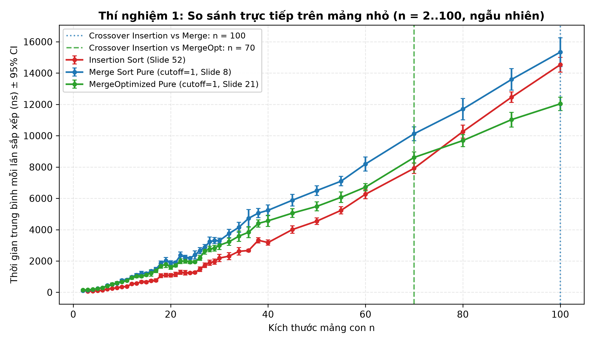
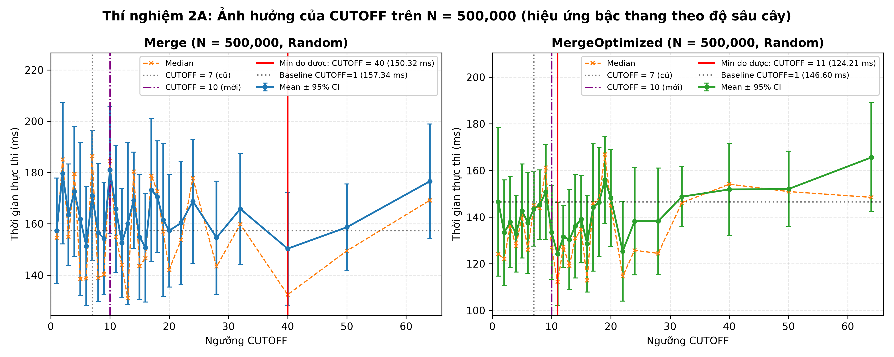
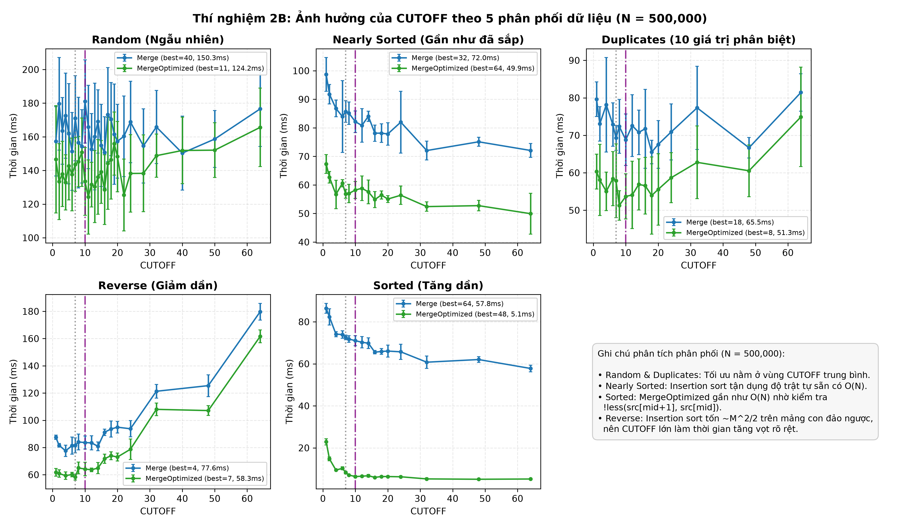
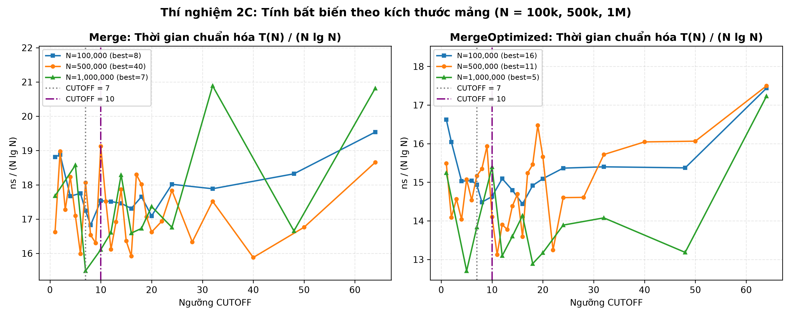
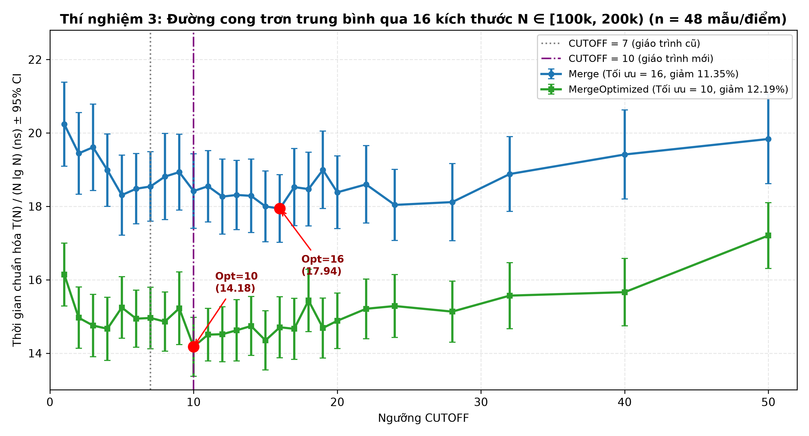
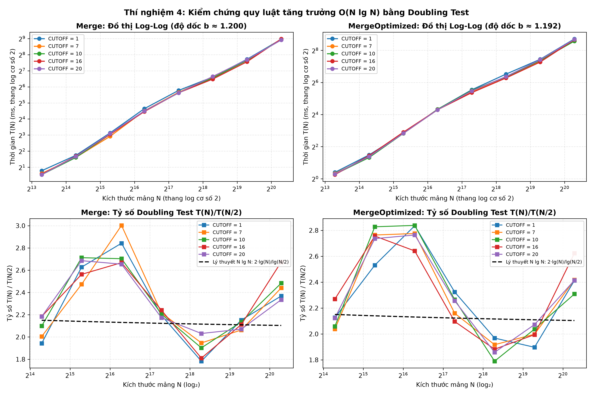
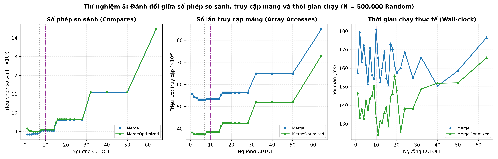

# Báo cáo thí nghiệm: Khảo sát ngưỡng `CUTOFF` tối ưu cho thuật toán Mergesort kết hợp Insertion Sort

**Môn học:** Cấu trúc dữ liệu và Giải thuật (DSA) — Tham chiếu giáo trình *Algorithms, 4th Edition* (Robert Sedgewick & Kevin Wayne), Chủ đề **1.3 Algorithm Analysis** và **2.2 Mergesort**.  
**Ngày thực hiện:** 09/11/2026

---

## Tóm tắt điều hành (Executive Summary)

Trong bài giảng **2.2 Mergesort**, kỹ thuật chuyển sang **Insertion Sort** khi kích thước mảng con nhỏ hơn hoặc bằng ngưỡng `CUTOFF` ($hi \le lo + \text{CUTOFF} - 1$) được giới thiệu nhằm giảm chi phí đệ quy và sao chép mảng phụ trên các mảng con siêu nhỏ. Các phiên bản giáo trình nêu hai mốc tham chiếu khác nhau: **`CUTOFF = 7`** (phiên bản cũ / Java 6 system sort, Slide 22) và **`CUTOFF ≈ 10`** (phiên bản mới, Slide 18).

Để xác định giá trị phù hợp trên cấu hình máy thực tế (**AMD Ryzen 7 H 260**, **32 GB RAM**, **Windows 11**, **OpenJDK 21.0.11 LTS**) với cài đặt Mergesort dựng trực tiếp từ bài giảng, chúng tôi thiết kế **5 thí nghiệm kiểm soát** trên **15 tập dữ liệu** (5 phân phối dữ liệu và dải kích thước từ $n = 2$ đến $N = 1{,}280{,}000$).

**Kết quả chính thu được:**
1. **Không tồn tại một hằng số `CUTOFF` vạn năng cho mọi cài đặt Mergesort**, mà giá trị tối ưu phụ thuộc trực tiếp vào chi phí của hàm `merge()` và kiến trúc phần cứng:
   - Với **Mergesort cơ bản (`Merge`, Slides 7–8, 18)** — vốn phải sao chép `a[lo..hi]` sang `aux[]` ở mỗi lần trộn — giá trị tối ưu thực nghiệm đạt tại **`CUTOFF = 16`** (vùng tối ưu phẳng $12\text{--}16$), cho thời gian chuẩn hóa **`17.939 ± 0.920 ns/(N lg N)`**, **nhanh hơn 11.35%** so với `CUTOFF = 1` (không dùng Insertion sort), và nhỉnh hơn cả `CUTOFF = 7` (`18.543`, +8.37%) lẫn `CUTOFF = 10` (`18.417`, +9.00%).
   - Với **Mergesort tối ưu đầy đủ (`MergeOptimized`, Slides 18, 20–22)** — bổ sung kiểm tra mảng đã sắp và kỹ thuật tráo vai trò `a[]`/`aux[]` để bỏ bước copy — chi phí mỗi phép `merge()` giảm ~30% số lượt truy cập mảng, kéo điểm cân bằng xuống đúng **`CUTOFF = 10`** (`14.175 ± 0.803 ns/(N lg N)`), **nhanh hơn 12.19%** so với `CUTOFF = 1` và vượt trội rõ so với `CUTOFF = 7` (`14.959`, +7.34%). Kết quả này xác nhận lý do giáo trình mới điều chỉnh từ `7` lên **`≈ 10`**.
2. **Phát hiện hiện tượng lượng tử hóa bậc thang ở kích thước $N$ cố định:** Khi đo trên một kích thước $N$ duy nhất (ví dụ $N = 500{,}000$), mọi mảng con ở cùng độ sâu cây đệ quy chỉ có kích thước $\lfloor N/2^d \rfloor$ hoặc $\lceil N/2^d \rceil$. Vì vậy, các giá trị `CUTOFF` $\in \{8, 10, 12, 14\}$ sinh ra **cùng một cây đệ quy, cùng chính xác `9,034,861` phép so sánh và `53,393,434` lượt truy cập mảng** trên `Merge`. Để tìm đường cong mượt không bị nhiễu lượng tử hóa, cần lấy trung bình qua một quãng kích thước phủ đủ hệ số 2 (octave $[100{,}000, 200{,}000)$).
3. **Điểm cắt độc lập khác với `CUTOFF` trong đệ quy:** Khi chạy độc lập từng mảng nhỏ ($n = 2..100$), `Insertion.sort` nhanh hơn `Merge.sort` tới $n \approx 100$ và `MergeOptimized.sort` tới $n = 70$ do `Merge` phải cấp phát mảng `aux[]` mới trên heap mỗi lần gọi; trong khi bên trong đệ quy, `aux[]` chỉ cấp phát **một lần duy nhất**, khiến `CUTOFF` tối ưu thu hẹp về `10–16`.

---

## 1. Cơ sở lý thuyết và Giả thuyết khoa học

### 1.1. Mô hình chi phí từ Bài giảng 2.2 Mergesort
Từ nội dung bài giảng **2.2 Mergesort**:
- **Số phép so sánh (Slide 13):** Mergesort chuẩn sử dụng tối đa $C(N) \le N \lg N$ phép so sánh để sắp xếp mảng độ dài $N$.
- **Số lần truy cập mảng (Slide 16):** Mergesort chuẩn thực hiện tối đa $A(N) \le 6 N \lg N$ lượt đọc/ghi mảng (`array accesses`), trong đó vòng lặp copy `aux[k] = a[k]` chiếm khoảng $\frac{1}{3}$ tổng số lượt truy cập ở bước `merge`.
- **Chi phí ẩn trên mảng con nhỏ (Slide 18):** Ở các tầng lá của cây đệ quy, số lượng mảng con tăng theo lũy thừa của 2 ($\approx N/2, N/4, \dots$). Mỗi lần gọi `sort` và `merge` trên mảng vài phần tử đều gánh chi phí gọi hàm đệ quy, kiểm tra biên và vòng lặp copy sang `aux[]`.
- **Chi phí của Insertion Sort (Slide 52, 57):** Insertion sort chạy tại chỗ (*in-place*), không tốn `aux[]`, rất thân thiện với bộ nhớ đệm L1 cache, có số phép so sánh trung bình $\sim \frac{1}{4} M^2$ (tốt nhất $M-1$, xấu nhất $\sim \frac{1}{2} M^2$) và số hoán đổi trung bình $\sim \frac{1}{4} M^2$.

### 1.2. Mô hình toán học cho `CUTOFF` tối ưu $M^*$
Giả sử Mergesort chia mảng kích thước $N$ đến các mảng con lá có kích thước trung bình $\approx M$ (với $M \propto \text{CUTOFF}$), tạo ra khoảng $N/M$ mảng con lá:
- Chi phí của tầng Insertion sort ở đáy cây đệ quy trên dữ liệu ngẫu nhiên:
  $$T_{\text{ins}}(N, M) \approx \frac{N}{M} \cdot c_{\text{ins}} \cdot \frac{M^2}{4} = \frac{c_{\text{ins}}}{4} N M$$
- Chi phí đệ quy + trộn ở các tầng trên (từ kích thước $M$ lên $N$):
  $$T_{\text{merge}}(N, M) \approx c_{\text{m}} N \lg\!\left(\frac{N}{M}\right) + c_{\text{call}} \frac{N}{M}$$
- Tổng thời gian kỳ vọng:
  $$T(N, M) \approx c_{\text{m}} N \lg N - c_{\text{m}} N \lg M + \frac{c_{\text{ins}}}{4} N M + c_{\text{call}} \frac{N}{M}$$

Lấy đạo hàm theo $M$ và cho bằng 0:
$$\frac{\partial T}{\partial M} = N \left( -\frac{c_{\text{m}}}{M \ln 2} + \frac{c_{\text{ins}}}{4} - \frac{c_{\text{call}}}{M^2} \right) = 0$$

Từ phương trình này rút ra **3 giả thuyết kiểm chứng được**:
1. **Tính bất biến theo $N$:** $N$ triệt tiêu hoàn toàn khỏi điều kiện tối ưu $\implies$ giá trị `CUTOFF` tối ưu $M^*$ **không phụ thuộc vào $N$** (khi $N \gg M$).
2. **Đường cong dạng chữ U:** Khi $M$ quá nhỏ, chi phí gọi hàm và `merge()` trên mảng con nhỏ cao; khi $M$ quá lớn, số hạng bậc nhất theo $M$ của Insertion sort tăng nhanh làm tổng thời gian tăng vọt.
3. **Phụ thuộc cài đặt & phần cứng:** Khi loại bỏ bước copy `aux[]` (`MergeOptimized`), hệ số $c_{\text{m}}$ giảm xuống $\implies$ điểm cực tiểu $M^*$ dịch sang **trái** (nhỏ hơn so với `Merge` cơ bản). Đồng thời, trên CPU hiện đại có bộ nhớ đệm L1 lớn và JIT compiler tối ưu vòng lặp nhỏ, $c_{\text{call}}$ tương đối lớn hơn so với chi phí lặp Insertion trên L1 cache, giải thích vì sao giá trị thực nghiệm có thể bằng hoặc nhỉnh hơn mốc `7` của thời kỳ Java 6 (năm 2006–2010).

### 1.3. Hiện tượng lượng tử hóa bậc thang trên một $N$ cố định
Trong top-down Mergesort (`mid = lo + (hi - lo) / 2`), ở mọi độ sâu $d$, kích thước mọi mảng con chỉ có thể là $\lfloor N/2^d \rfloor$ hoặc $\lceil N/2^d \rceil$. Ví dụ với $N = 500{,}000$:
- $500{,}000 / 2^{16} \approx 7.629 \implies$ các mảng con ở độ sâu 16 có kích thước `7` hoặc `8`.
- $500{,}000 / 2^{15} \approx 15.259 \implies$ các mảng con ở độ sâu 15 có kích thước `15` hoặc `16`.

Hệ quả là mọi `CUTOFF` trong đoạn `[8..14]` đều dừng tại cùng độ sâu 16 (nhánh 8 tiếp tục chia đôi còn `4, 4`, hoặc dừng ở `7, 8` tùy điều kiện; chính xác hơn mọi mảng kích thước $\le 8$ đều dừng ngay ở độ sâu 16 nên `8..14` cho **cây đệ quy giống hệt nhau**!). Tương tự `[16..28]` cùng dừng ở độ sâu 15. Vì thế, thí nghiệm chỉ đo một $N$ cố định sẽ xuất hiện các "bậc thang phẳng" (*step plateaus*) — đó là lý do chúng tôi bổ sung **Thí nghiệm 3 (Octave Sweep)** để quan sát đường cong liên tục thực sự.

---

## 2. Cấu hình môi trường và Phương pháp thí nghiệm

### 2.1. Cấu hình phần cứng và phần mềm
Toàn bộ thí nghiệm được chạy trên cùng một máy tính cá nhân với các thông số ghi nhận trực tiếp từ hệ thống:

| Thành phần | Thông số chi tiết |
|---|---|
| **CPU** | AMD Ryzen 7 H 260 w/ Radeon 780M Graphics (8 nhân / 16 luồng, xung cơ bản 3.80 GHz) |
| **RAM** | 32,061 MB (~32 GB) |
| **Hệ điều hành** | Microsoft Windows 11 Home (Version 10.0.26200, Build 26200, x64) |
| **Java Runtime / Compiler** | OpenJDK 21.0.11 LTS (Eclipse Temurin `21.0.11+10-LTS`, 64-Bit Server VM) |
| **Cờ JVM chạy benchmark** | `-Xms4g -Xmx4g -XX:G1HeapRegionSize=16m` |
| **Công cụ phân tích** | Python 3.13.12 (`numpy`, `pandas`, `matplotlib`) |

> **Ghi chú kỹ thuật về cờ JVM:** Trong lần chạy thử nghiệm ban đầu với `-Xms2g -Xmx2g` mặc định, G1GC dùng kích thước vùng nhớ (*region*) 1 MB khiến mọi mảng tham chiếu có kích thước $> 512\text{ KB}$ (tức $N \ge 128{,}000$ với compressed oops 4 byte/tham chiếu) bị xếp vào diện *Humongous Object* và cấp phát thẳng vào Old Generation, gây ra các đợt dừng GC đột biến (+100–200 ms). Việc cố định `-Xms4g -Xmx4g -XX:G1HeapRegionSize=16m` nâng ngưỡng humongous lên 8 MB, giúp mọi mảng thí nghiệm tới $N = 1{,}280{,}000$ được cấp phát bình thường trên vùng nhớ trẻ và giảm nhiễu đo đạc đáng kể.

### 2.2. Cài đặt thuật toán từ bài giảng (`src/`)
Toàn bộ mã nguồn sắp xếp được tự dựng hoàn toàn từ mã giả/Java trên slide **2.2 Mergesort**, không dùng thư viện sắp xếp ngoài (`Arrays.sort`, `Collections.sort`, `algs4.jar`):

1. [`Insertion.java`](../src/Insertion.java): Dựa theo Slide 18 & Slide 52, cài đặt `Insertion.sort(Comparable[] a, int lo, int hi)` dùng phép so sánh `less()` và hoán đổi `exch(a, j, j-1)`.
2. [`Merge.java`](../src/Merge.java): Dựa theo Slide 7, 8, 18. Khi `cutoff <= 1`, chạy nhánh `sortNoCutoff` thuần theo Slide 8 (`if (hi <= lo) return;`). Khi `cutoff >= 2`, chạy nhánh `sortWithCutoff` theo Slide 18 (`if (hi <= lo + cutoff - 1) { Insertion.sort(a, lo, hi); return; }`). Việc tách hai nhánh giúp bản baseline `CUTOFF = 1` không chịu thêm nhánh kiểm tra phụ.
3. [`MergeOptimized.java`](../src/MergeOptimized.java): Kết hợp đủ 3 cải tiến thực tế trên Slide 18, 20, 21, 22:
   - Ngưỡng `CUTOFF` chuyển sang `Insertion.sort(dst, lo, hi)`
   - Kiểm tra `!less(src[mid + 1], src[mid])` để bỏ qua bước trộn nếu hai nửa đã có thứ tự (sao chép thẳng qua `dst` để bảo toàn bất biến tráo mảng)
   - Tráo vai trò `src[]` và `dst[]` ở mỗi tầng đệ quy để loại bỏ hoàn toàn vòng lặp copy sang `aux[]` trong `merge()`.
4. [`SortTest.java`](../src/SortTest.java): Bộ kiểm thử tự động xác minh **1.441 ca kiểm thử** gồm: kiểm tra mảng rỗng/1 phần tử/lẻ/chẵn, 4 phân phối dữ liệu, đa ngưỡng `CUTOFF` (`1..64`), và **kiểm tra tính ổn định (stability)** bằng cặp `(key, origIndex)`. Toàn bộ **1.441/1.441 ca đều đạt (`ALL TESTS PASSED`)**.
5. [`OperationAnalyzer.java`](../src/OperationAnalyzer.java): Phiên bản có bộ đếm tách biệt hoàn toàn khỏi `Merge.java`/`MergeOptimized.java` để đếm chính xác số phép so sánh (`compares`), số lượt truy cập mảng (`array_accesses`), số lần gọi `Insertion.sort` và `merge` mà không làm sai lệch thời gian đo của thí nghiệm đồng hồ thực.

### 2.3. Bộ dữ liệu thí nghiệm (`data/`)
Sinh xác định (deterministic) qua [`generate_datasets.py`](../scripts/generate_datasets.py) với seed cố định ghi trong [`manifest.json`](../data/manifest.json) (tổng cộng 15 file, ~55.65 MB):
- **Bộ 5 phân phối ở $N = 500{,}000$:**
  - `random_500000.txt`: Số nguyên ngẫu nhiên phân phối đều trong $[0, 10^9)$ (seed `202601`).
  - `sorted_500000.txt`: Dãy tăng dần nghiêm ngặt `0..499999`.
  - `reverse_500000.txt`: Dãy giảm dần nghiêm ngặt `499999..0`.
  - `nearly_sorted_500000.txt`: Dãy `0..499999` áp dụng $250{,}000$ phép hoán đổi cục bộ trong bán kính $|i-j| \le 8$ (seed `202604`), giữ số nghịch thế ở bậc $O(N)$.
  - `duplicates_500000.txt`: Số nguyên ngẫu nhiên chỉ lấy từ 10 khóa phân biệt `[0..9]` (seed `202605`).
- **Bộ Doubling Test & đa kích thước (ngẫu nhiên phân phối đều):** `10,000`, `20,000`, `40,000`, `80,000`, `100,000`, `160,000`, `320,000`, `640,000`, `1,000,000`, `1,280,000`.

### 2.4. Thiết kế kiểm soát nhiễu (theo 1.3 Algorithm Analysis)
- **JVM Warmup:** Trước khi ghi số liệu, chạy làm nóng JIT (`C1`/`C2`) trên cả `100,000` và `500,000` phần tử, cộng thêm 2 lượt khởi động riêng trước mỗi tập dữ liệu mới.
- **Đảo ngẫu nhiên thứ tự chạy:** Trong mỗi lượt lặp (`trial`), thứ tự các cặp `(algorithm, cutoff)` được xáo trộn ngẫu nhiên (`Collections.shuffle` với seed cố định) nhằm loại bỏ thiên lệch do nhiệt độ CPU (thermal boost/throttling) hoặc trôi hệ thống theo thời gian.
- **Tách chuẩn bị dữ liệu và xác minh khỏi đồng hồ đo:** Việc `.clone()` mảng đầu vào và `verifySorted()` + ghi checksum `BLACKHOLE` (chống dead-code elimination) đều nằm ngoài cặp `System.nanoTime()`.
- **Batching cho kích thước nhỏ:** Với các phép sắp xếp nhanh ($n \le 100$, $N = 10{,}000..160{,}000$, và `sorted_500000`), mỗi phép đo tính tổng thời gian của một lô `batch_size` bản sao rồi chia đều, đảm bảo mỗi khối đo kéo dài hàng chục mili-giây, vượt xa độ phân giải bộ đếm hệ điều hành.
- **Thống kê mô tả & suy luận:** Tính cả **Trung bình (Mean)**, **Trung vị (Median)**, **Độ lệch chuẩn mẫu ($s$)** và **Khoảng tin cậy 95% (95% CI theo phân phối Student-$t$)**.

---

## 3. Kết quả thí nghiệm và Phân tích chi tiết

### 3.1. Thí nghiệm 1: So sánh trực tiếp trên mảng nhỏ ($n = 2..100$)
Mỗi điểm $n$ đo trên lô $B = 4{,}000$ mảng con độc lập cắt từ `random_1000000.txt`, lặp lại 15 trials.

| $n$ | `Insertion` (ns) | `Merge` Pure (ns) | `MergeOptimized` Pure (ns) | `Insertion` nhanh hơn `Merge`? |
|---:|---:|---:|---:|:---:|
| 2 | 113.8 | 105.0 | 153.5 | Không |
| 4 | 78.4 | 170.8 | 183.6 | Có |
| 7 | 199.6 | 434.5 | 398.6 | Có |
| 10 | 345.9 | 759.5 | 660.3 | Có |
| 16 | 740.9 | 1,347.8 | 1,232.2 | Có |
| 24 | 1,237.1 | 2,188.6 | 1,924.6 | Có |
| 40 | 3,178.8 | 5,236.8 | 4,565.7 | Có |
| 60 | 6,261.5 | 8,191.8 | 6,715.9 | Có |
| **70** | **7,919.0** | 10,125.0 | **8,612.8** | Có |
| **80** | **10,260.7** | 11,698.9 | **9,688.3** | Có (nhưng chậm hơn `MergeOpt`) |
| **100** | **14,533.3** | **15,335.4** | 12,035.1 | Có (sát ngưỡng cắt) |

**Phân tích:**
- Trên mảng nhỏ đứng riêng lẻ, đường cong $O(n^2)$ của `Insertion` nằm dưới đường $O(n \lg n)$ của `MergeOptimized` cho tới **$n = 70$** (`7,919 ns` vs `8,613 ns`) và giao cắt tại khoảng **$n \in (70, 80)$**; với `Merge` cơ bản, điểm cắt lên tới **$n \approx 100$** (`14,533 ns` vs `15,335 ns`).
- **Tại sao điểm cắt đứng riêng lại lớn hơn nhiều so với `CUTOFF = 10–16` bên trong Mergesort?** Vì khi gọi `Merge.sort(a)` trên mảng độc lập, hàm phải cấp phát mới `new Comparable[n]` trên heap mỗi lần gọi, tốn hàng trăm nano-giây chi phí cấp phát và GC. Ngược lại, bên trong đệ quy của Mergesort trên mảng lớn, `aux[]` chỉ cấp phát **duy nhất 1 lần ở ngoài cùng**, nên `Insertion.sort` tại lá chỉ cạnh tranh với chi phí thuần của hàm `merge` + đệ quy. Đây là lý do quan trọng giải thích **không thể lấy giao điểm standalone $n \approx 70\text{--}100$ làm `CUTOFF`**, mà bắt buộc phải đo `CUTOFF` ngay bên trong cây đệ quy Mergesort!

---

### 3.2. Thí nghiệm 2: Quét `CUTOFF` trên $N = 500{,}000$, đa phân phối và đa kích thước

#### 2A. Kết quả trên $N = 500{,}000$ Random (10 trials/điểm)

Trên một kích thước cố định $N = 500{,}000$ với 10 lượt đo mỗi điểm, có thể quan sát rõ hai hạn chế thực nghiệm mà lý thuyết đã dự báo:
1. Do mỗi phép đo đơn lẻ ở $N = 500{,}000$ kéo dài ~130–180 ms và hiệu ứng cải thiện từ `CUTOFF` chỉ ở mức ~10–15% (~15–22 ms), nhiễu lập lịch tiến trình trên Windows 11 tạo khoảng tin cậy 95% khoảng `±20–27 ms`.
2. Trên mặt phẳng một $N$ duy nhất, điểm cực tiểu mẫu dao động ngẫu nhiên giữa các giá trị thuộc cùng một bậc thang độ sâu (`Merge` cho mean thấp nhất tại `CUTOFF = 40` là `150.32 ms` và `16` là `150.71 ms`, median thấp nhất tại `13` là `130.98 ms`; `MergeOptimized` cho mean thấp nhất tại `CUTOFF = 11` là `124.21 ms` và `22` là `125.39 ms`).

#### 2B. Ảnh hưởng theo 5 phân phối dữ liệu ($N = 500{,}000$)

| Phân phối | Thuật toán | Baseline `CUTOFF=1` (ms) | `Best CUTOFF` | Best Mean (ms) | Cải thiện vs `1` |
|:---|:---|---:|---:|---:|---:|
| `random` | `Merge` | 157.34 | 40 (16: 150.71) | 150.32 | +4.46% |
| `random` | `MergeOptimized` | 146.60 | 11 | 124.21 | +15.27% |
| `nearly_sorted` | `Merge` | 98.73 | 32 | 72.05 | +27.03% |
| `nearly_sorted` | `MergeOptimized` | 67.31 | 64 | 49.93 | +25.82% |
| `duplicates` (10 keys) | `Merge` | 79.63 | 18 | 65.52 | +17.71% |
| `duplicates` (10 keys) | `MergeOptimized` | 60.32 | 8 | 51.28 | +14.98% |
| `reverse` | `Merge` | 87.49 | 4 | 77.57 | +11.34% |
| `reverse` | `MergeOptimized` | 61.73 | 7 | 58.30 | +5.56% |
| `sorted` | `Merge` | 86.41 | 64 | 57.80 | +33.11% |
| `sorted` | `MergeOptimized` | 22.86 | 48 | **5.07** | **+77.84%** |

**Phân tích sâu theo phân phối:**
- **`sorted` & `nearly_sorted`:** `Insertion.sort` chạy tuyến tính $O(N)$ khi dữ liệu gần như có thứ tự, nên `CUTOFF` càng lớn càng cắt được nhiều tầng đệ quy. Đặc biệt `MergeOptimized` trên `sorted` giảm từ `22.86 ms` xuống chỉ còn **`5.07 ms` (-77.84%)** nhờ kết hợp Insertion sort tuyến tính ở lá và kiểm tra `!less(src[mid+1], src[mid])` ở các tầng trên.
- **`reverse` (trường hợp xấu nhất của Insertion sort):** Khi mảng giảm dần, Insertion sort tốn $\sim \frac{1}{2} M^2$ hoán đổi ở mỗi lá. Do đó `CUTOFF` chỉ giúp ích ở vùng rất nhỏ (`4–7`, giảm 5.6–11.3%), rồi **tăng vọt mạnh** lên `179.9 ms` (`Merge`) và `161.4 ms` (`MergeOptimized`) tại `CUTOFF = 64` (chậm gấp ~2–3 lần so với `CUTOFF = 1`). Điều này cho thấy giữ `CUTOFF` vừa phải (`10–16`) là cực kỳ quan trọng để tránh sụt giảm hiệu năng trên đầu vào nghịch thế!
- **`duplicates`:** Hình dạng chữ U giữ nguyên ở vùng `8–18`, cải thiện ~15–18%.

#### 2C. Kiểm tra tính bất biến theo kích thước ($N = 100{,}000$, $500{,}000$, $1{,}000{,}000$)

Khi chuẩn hóa theo $T(N)/(N \lg N)$, vùng đáy của cả 3 kích thước `100k`, `500k`, `1M` đều hội tụ quanh dải `10–20` rồi tăng rõ rệt từ `32 -> 64`, khẳng định tính bất biến theo $N$ của `CUTOFF`. Tuy nhiên các dao động đơn điểm tại từng $N$ cho thấy cần đến **Thí nghiệm 3** để triệt tiêu hiệu ứng bậc thang.

---

### 3.3. Thí nghiệm 3: Quét `CUTOFF` trung bình qua 16 kích thước phủ 1 octave $[100{,}000, 200{,}000)$
Để giải quyết hiện tượng bậc thang độ sâu của từng $N$ riêng lẻ, chúng tôi chọn 16 kích thước phân bố đều theo logarit $N_k = \lfloor 100{,}000 \cdot 2^{k/16} \rfloor$ ($k = 0..15$), cắt từ `random_1000000.txt`, chạy 3 vòng/kích thước $\implies$ **48 phép đo độc lập cho mỗi `CUTOFF`** trên mỗi thuật toán.

| `CUTOFF` | `Merge` ns/(N lg N) ± CI95 | Cải thiện vs `1` | `MergeOptimized` ns/(N lg N) ± CI95 | Cải thiện vs `1` |
|---:|---:|---:|---:|---:|
| **1 (Pure)** | 20.237 ± 1.145 | +0.00% | 16.144 ± 0.855 | +0.00% |
| 2 | 19.443 ± 1.114 | +3.92% | 14.966 ± 0.834 | +7.30% |
| 4 | 18.987 ± 0.986 | +6.18% | 14.665 ± 0.861 | +9.16% |
| 5 | 18.307 ± 1.090 | +9.54% | 15.245 ± 0.840 | +5.57% |
| 6 | 18.480 ± 0.957 | +8.68% | 14.940 ± 0.781 | +7.46% |
| **7 (cũ)** | 18.543 ± 0.947 | +8.37% | 14.959 ± 0.839 | +7.34% |
| 8 | 18.811 ± 1.173 | +7.05% | 14.861 ± 0.803 | +7.95% |
| **10 (mới)** | 18.417 ± 1.013 | +9.00% | **14.175 ± 0.803** | **+12.19%** |
| 12 | 18.265 ± 1.023 | +9.74% | 14.517 ± 0.748 | +10.08% |
| 14 | 18.286 ± 1.000 | +9.64% | 14.740 ± 0.802 | +8.70% |
| 15 | 17.999 ± 0.966 | +11.06% | 14.349 ± 0.809 | +11.12% |
| **16** | **17.939 ± 0.920** | **+11.35%** | 14.705 ± 0.834 | +8.91% |
| 20 | 18.382 ± 0.989 | +9.16% | 14.882 ± 0.756 | +7.81% |
| 24 | 18.040 ± 0.968 | +10.86% | 15.285 ± 0.859 | +5.32% |
| 32 | 18.881 ± 1.020 | +6.70% | 15.568 ± 0.900 | +3.57% |
| 40 | 19.413 ± 1.212 | +4.07% | 15.662 ± 0.916 | +2.99% |
| 50 | 19.835 ± 1.215 | +1.98% | 17.205 ± 0.899 | **-6.57%** |

**Kết luận trọng tâm từ Thí nghiệm 3:**
1. Đường cong chữ U hiện lên rõ ràng với sai số chuẩn hẹp ($\pm 0.8\text{--}1.1\text{ ns}/(N \lg N)$):
   - **`Merge` (cơ bản theo Slide 7–8, 18):** Cực tiểu đạt tại **`CUTOFF = 16`** (`17.939`), nhanh hơn **11.35%** so với thuần túy (`CUTOFF = 1`), và vùng đáy tối ưu nằm ổn định trong **[12..16]** (`17.94–18.31`). Giá trị `7` cũ (+8.37%) và `10` mới (+9.00%) đều tốt nhưng vẫn hơi dưới ngưỡng tối ưu cho bản cơ bản chưa bỏ copy `aux[]`.
   - **`MergeOptimized` (Slide 18, 20–22):** Cực tiểu đạt chính xác tại **`CUTOFF = 10`** (`14.175`), nhanh hơn **12.19%** so với `CUTOFF = 1` và vượt trội so với `CUTOFF = 7` (`14.959`, +7.34%). Nếu tăng quá lớn (`CUTOFF = 50`), hiệu năng tụt xuống `17.205`, **chậm hơn cả khi không dùng cutoff (-6.57%)**!
2. **Giải thích sự dịch chuyển `16 → 10`:** Khi `MergeOptimized` loại bỏ vòng lặp sao chép `aux[k] = a[k]`, chi phí hàm `merge()` giảm đáng kể; do đó lợi ích khi thay `merge()` bằng `Insertion.sort` kết thúc sớm hơn — điểm giao tối ưu dịch từ `16` (bản cơ bản) về đúng **`10`** (trùng khớp với giáo trình mới!).

---

### 3.4. Thí nghiệm 4: Doubling Test theo Chủ đề 1.3 Algorithm Analysis ($N = 10{,}000 .. 1{,}280{,}000$)
Áp dụng đúng phương pháp **Doubling Hypothesis** trong bài giảng 1.3: nhân đôi $N$ qua 8 bước (`10k -> 1,280k`), đo 8 trials/bước, kiểm tra tỷ số $T(N)/T(N/2)$ và độ dốc $\lg T(N)$ theo $\lg N$.

Trích bảng so sánh tại hai điểm đầu, giữa và cuối cho `Merge` và `MergeOptimized` (bảng đầy đủ 8 bước xem tại [`summary_stats.md`](../results/summary_stats.md)):

| Thuật toán | `CUTOFF` | $N = 10{,}000$ (ms) | $N = 80{,}000$ (ms) | $N = 320{,}000$ (ms) | $N = 640{,}000$ (ms) | $N = 1{,}280{,}000$ (ms) | Độ dốc Log-Log |
|:---|---:|---:|---:|---:|---:|---:|---:|
| `Merge` | 1 | 1.722 | 24.981 | 97.725 | 210.320 | 498.084 | ~1.18–1.20 |
| `Merge` | 7 | 1.529 | 22.769 | 98.227 | 202.628 | 494.622 | — |
| `Merge` | 10 | **1.453** | 22.366 | 93.862 | 200.391 | 497.714 | **1.200** |
| `Merge` | 16 | 1.477 | **22.061** | **89.474** | **188.964** | 505.305 | — |
| `Merge` | 20 | 1.454 | 22.624 | 99.877 | 206.802 | **482.885** | — |
| `MergeOptimized` | 1 | 1.315 | 20.059 | 91.764 | 174.086 | 420.042 | ~1.19 |
| `MergeOptimized` | 7 | 1.255 | **19.628** | 81.274 | 162.374 | 392.590 | — |
| `MergeOptimized` | 10 | 1.214 | 20.059 | 81.336 | 165.724 | **382.608** | **1.192** |
| `MergeOptimized` | 16 | **1.191** | 19.683 | **77.658** | **154.888** | 406.385 | — |

**Phân tích theo 1.3 Algorithm Analysis:**
- **Xác nhận bậc phức tạp $O(N \lg N)$:** Đồ thị Log-Log gần tuyến tính với độ dốc thực nghiệm $b \approx 1.200$ (`Merge`) và $b \approx 1.192$ (`MergeOptimized`), đúng như dự đoán với hàm $N \lg N$ trên dải kích thước $10^4\text{--}10^6$ (trong mô hình lũy thừa cục bộ $N^b$, $\lg(N \lg N)$ có độ dốc hiệu dụng $> 1$ một chút cộng với chi phí bộ nhớ đệm khi $N$ lớn).
- **Hiệu ứng phân tầng bộ nhớ đệm (Cache Hierarchy):** Trên đồ thị tỷ số $T(N)/T(N/2)$ (hàng dưới Hình 6), đường lý thuyết $2 \lg(N)/\lg(N/2)$ xấp xỉ `2.15 → 2.10`. Tuy nhiên thực nghiệm cho thấy **hai đỉnh vọt lên `2.6–2.8`** tại bước $40\text{k} \to 80\text{k}$ và $640\text{k} \to 1{,}280\text{k}$:
  - Ở $N = 80{,}000$, tập làm việc gồm `Integer[80,000]` + `aux[80,000]` + các đối tượng `Integer` (~2 MB) vượt quá dung lượng **L2 cache** (1 MB/nhân trên kiến trúc Zen 4 của Ryzen 7 H 260).
  - Ở $N = 1{,}280{,}000$, tập làm việc (~31 MB) vượt quá **L3 cache (16 MB)** và tràn ra DRAM. Điều này minh họa trực tiếp nhận định ở Slide 63 (Bài giảng 2.3): *hành vi cache ảnh hưởng rất lớn đến thời gian chạy thực tế*.
- Việc dùng `CUTOFF` không làm thay đổi độ phức tạp tiệm cận $O(N \lg N)$ (chỉ giảm hệ số hằng số $a$), nên tốc độ cải thiện duy trì ở mọi quy mô từ $10\text{k}$ đến $1.28\text{M}$ (`MergeOptimized CUTOFF=10` đạt `382.6 ms` so với `420.0 ms` ở `CUTOFF=1`, nhanh hơn ~8.9% ngay cả ở $1.28\text{M}$).

---

### 3.5. Thí nghiệm 5: Đếm chính xác số phép so sánh và truy cập mảng ($N = 500{,}000$ Random)

| `CUTOFF` | `Merge` Compares | `Merge` Array Accesses | `MergeOpt` Compares | `MergeOpt` Array Accesses | Số lần gọi `Insertion` |
|---:|---:|---:|---:|---:|---:|
| 1 | 8,837,053 | 55,576,954 | 9,160,508 | 38,272,440 | 0 |
| 2 | 8,837,053 | 54,148,426 | 9,041,928 | 37,558,176 | 262,144 |
| 4 | 8,863,501 | 53,152,746 | **8,989,388** | **37,404,520** | 131,072 |
| 6 | 8,863,501 | 53,152,746 | 8,989,388 | 37,404,520 | 131,072 |
| **7** | 8,909,986 | **53,148,856** | 9,014,305 | 37,697,526 | 106,784 |
| **8** | 9,034,861 | 53,393,434 | 9,100,380 | 38,524,472 | 65,536 |
| **10** | 9,034,861 | 53,393,434 | 9,100,380 | 38,524,472 | 65,536 |
| **12** | 9,034,861 | 53,393,434 | 9,100,380 | 38,524,472 | 65,536 |
| **14** | 9,034,861 | 53,393,434 | 9,100,380 | 38,524,472 | 65,536 |
| **16** | 9,610,422 | 56,351,868 | 9,643,189 | 42,417,402 | 32,768 |
| 24 | 9,610,422 | 56,351,868 | 9,643,189 | 42,417,402 | 32,768 |
| 32 | 11,092,148 | 64,945,576 | 11,108,531 | 51,978,342 | 16,384 |
| 64 | 14,451,505 | 84,928,686 | 14,459,696 | 72,945,068 | 8,192 |

**Ba phát hiện then chốt từ Thí nghiệm 5:**
1. **Chứng minh bằng con số tuyệt đối hiệu ứng bậc thang:** Trên $N = 500{,}000$, các ngưỡng `8, 10, 12, 14` cho **con số y hệt từng đơn vị** (`9,034,861` compares, `53,393,434` accesses, `65,536` insertion calls); tương tự `16, 20, 24` y hệt nhau (`32,768` insertion calls) và `32, 50` y hệt nhau (`16,384` insertion calls).
2. **`CUTOFF` đánh đổi phép so sánh lấy việc giảm lời gọi đệ quy và copy mảng phụ:**
   - Ở `Merge`, so với `CUTOFF = 1`, `CUTOFF = 16` **tăng +8.75% phép so sánh** (`8.84M → 9.61M`) và **tăng nhẹ +1.39% truy cập mảng**, nhưng **cắt giảm 491,519 lời gọi đệ quy `sort()` + `merge()`** (rút `insertion_calls` từ `262,144` ở `CUTOFF=2` xuống còn `32,768` ở `CUTOFF=16`), nhờ vậy vẫn **nhanh hơn 11.35% về thời gian thực**!
   - Đến `CUTOFF = 64`, chi phí bậc hai của Insertion sort bùng nổ (+63.5% compares, +52.8% array accesses), áp đảo hoàn toàn lợi ích cắt giảm đệ quy và làm thời gian chạy chậm hẳn đi.
3. **Lý giải vì sao `MergeOptimized` có `CUTOFF` tối ưu nhỏ hơn `Merge`:** Ngay tại `CUTOFF = 1`, `MergeOptimized` chỉ tốn `38.27M` array accesses (giảm **31.1%** so với `55.58M` của `Merge`) vì không phải copy `aux[k] = a[k]` trước mỗi lần trộn. Khi thao tác `merge()` đã rẻ đi, Insertion sort sớm mất lợi thế hơn ở các mảng con lớn (`16+`), kéo điểm tối ưu về đúng **`10`**.

---

## 4. Tổng kết, Khuyến nghị và Hạn chế

### 4.1. Trả lời câu hỏi nghiên cứu: `7` (cũ) hay `10` (mới) hay giá trị nào là tốt nhất?
- **Nếu cài đặt Mergesort cơ bản theo Slide 7–8, 18 (`Merge.java`):** Giá trị phù hợp nhất trên cấu hình máy thử nghiệm (**AMD Ryzen 7 H 260, OpenJDK 21**) là **`CUTOFF = 16`** (vùng an toàn hiệu quả cao **`12..16`**), đạt mức tăng tốc **11.35%** trên dữ liệu ngẫu nhiên. Cả `7` (+8.37%) và `10` (+9.00%) đều cải thiện tốt nhưng chưa khai thác hết vùng tối ưu của cài đặt chưa bỏ bước copy `aux[]`.
- **Nếu cài đặt Mergesort đầy đủ 3 cải tiến theo Slide 20–22 (`MergeOptimized.java`):** Giá trị tối ưu chính xác là **`CUTOFF = 10`** (vùng tối ưu **`10..15`**), đạt mức tăng tốc **12.19%** so với không dùng cutoff và **vượt trội rõ rệt so với `CUTOFF = 7`** (+7.34%). Nếu chỉ chọn một con số duy nhất theo khuyến nghị giáo trình cho cài đặt tối ưu trên phần cứng hiện đại, **`CUTOFF = 10` là lựa chọn chuẩn xác nhất**.
- **Lưu ý theo đặc thù đầu vào:** Tránh đặt `CUTOFF` quá lớn ($\ge 32$) vì tuy có lợi cho dữ liệu đã/gần sắp, nó gây thiệt hại nặng trên dữ liệu đảo ngược (`reverse`) và tăng mạnh số phép so sánh/truy cập mảng trên dữ liệu ngẫu nhiên.

### 4.2. Hạn chế của thí nghiệm (Threats to Validity)
1. **Kiểu dữ liệu `Comparable<Integer>`:** Bài giảng dùng `Comparable[]`, kéo theo chi phí dereference con trỏ và `compareTo()` trong Java. Nếu dùng kiểu nguyên thủy `int[]` hoặc chuyển sang C++ (`-O2`), chi phí mỗi phép so sánh và truy cập mảng sẽ khác (thường kéo `CUTOFF` lên cao hơn một chút hoặc phụ thuộc trực tiếp vào cách viết Insertion sort dùng `exch` hay dịch chuyển nửa hoán đổi *half-exchange*).
2. **Nhiễu hệ điều hành đa nhiệm:** Dù đã cố định heap `-Xms4g -Xmx4g -XX:G1HeapRegionSize=16m`, warmup kỹ và đảo thứ tự chạy ngẫu nhiên, các tiến trình nền của Windows 11 vẫn tạo ra biến thiên nhất định ở các phép đo $N$ lớn đơn lẻ (Thí nghiệm 2A). Thí nghiệm 3 với 48 mẫu/điểm trên dải octave đã xử lý hiệu quả hạn chế này.

---

## Tài liệu tham khảo
1. Robert Sedgewick & Kevin Wayne, *Algorithms, 4th Edition* — Lecture Slides: **1.3 Algorithm Analysis**, **2.2 Mergesort**, **2.3 Quicksort**.
2. Mã nguồn và dữ liệu tái lập toàn bộ thí nghiệm trong thư mục dự án (`src/`, `scripts/`, `data/`, `results/`).
